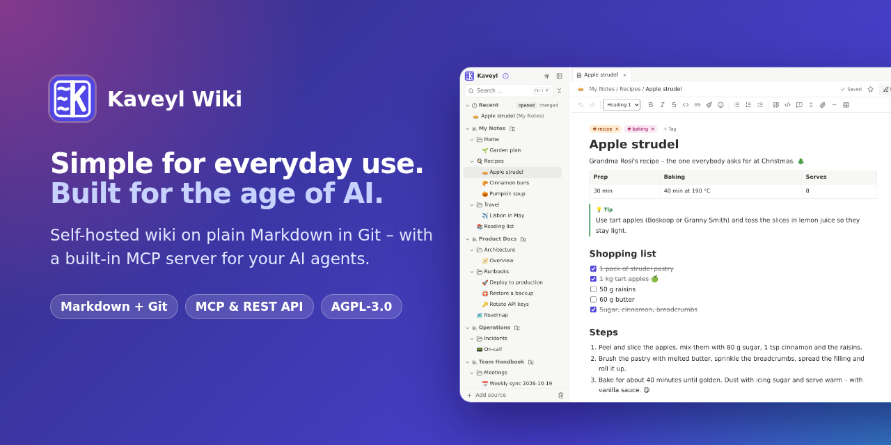

  <a href="https://github.com/kaveyl/wiki"><b>Kaveyl Wiki on GitHub</b></a> ·
  <a href="https://kaveyl.app">Website</a> ·
  <a href="https://kaveyl.app/features/">All features</a> ·
  <a href="https://github.com/kaveyl/wiki/blob/main/deploy/INSTALLATION.md">Install</a> ·
  <a href="https://github.com/kaveyl/wiki/releases">Releases</a>

### Calm, self-hosted tools for notes and knowledge

**Kaveyl Wiki** is a self-hosted wiki for personal notes, documentation and team projects – as easy as a modern notes
app, with plain Markdown files in Git underneath.

- **For everyday use** – nested folders, drag and drop, templates, coloured tags and an editor that shows formatting as you type.
- **For developers** – every page stays a Markdown file in a Git repository; edit it in VS Code, Neovim or with `git`.
- **For AI agents** – a built-in MCP server and a REST API, never with more rights than the account behind the token.

Free software under the AGPL-3.0 · one Docker container · English and German
